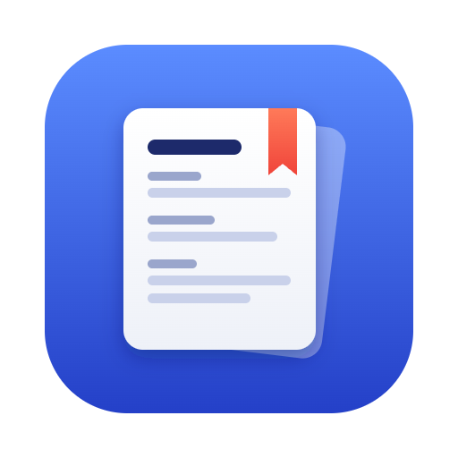

# Rowbook

Read spreadsheets like a book. Open a CSV or Excel file (Google Forms responses, applications, sign-ups) and each row becomes a page you scroll through sideways. Group by any column, search by name or ID, and export one page or a whole group as a PDF.

- **Private:** everything runs in your browser tab. Nothing is uploaded, nothing is stored, and closing the tab clears it.
- **Nothing to install:** open the hosted page, or download this folder and double-click `index.html` (it works offline too).
- **PDF styles:** Apple, Notion, GitHub, Minimal and Amoako, the same CSS themes as [mdpdf](https://github.com/nanadotam/mdpdf-cli). Click a PDF button and pick **Save as PDF** in the print dialog.
- **Text file:** the **Text file** button gives you a file you can run through `mdpdf` yourself.

## Using it

1. Drop a `.csv` / `.xlsx` on the page (or paste a Google Sheets link shared as "anyone with the link").
2. Pick **Group by**, for example the committee column. Click a chip to see only that group.
3. Click any card to read it in a side panel (press F for full page). ← → moves between people, Esc closes, and the browser Back button works too.
4. **Hide fields** lets you hide columns like Timestamp or Email.
5. **Save all as PDF** (or **Save “Group” as PDF**) gives a cover page with counts, then one page per row.

`sample.csv` is made-up data to try it with.

Built on [SheetJS](https://sheetjs.com) (Apache-2.0) and [Phosphor Icons](https://phosphoricons.com) (MIT), both bundled in `vendor/`.
